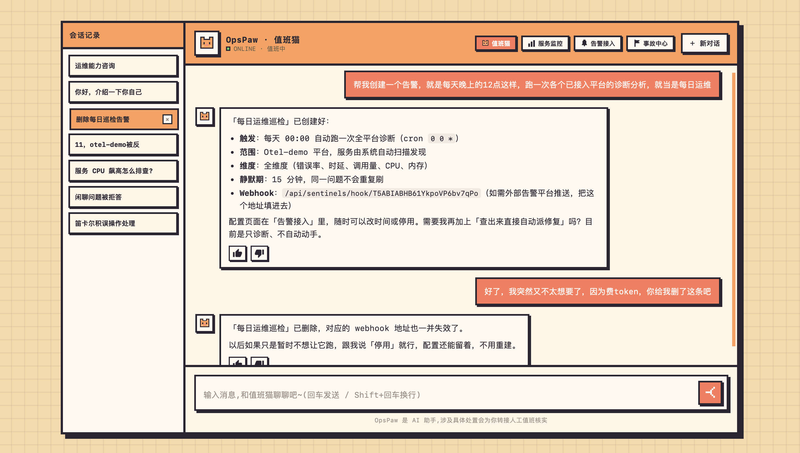
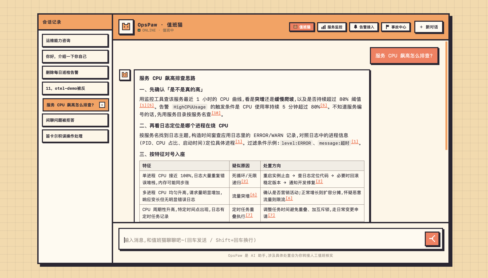
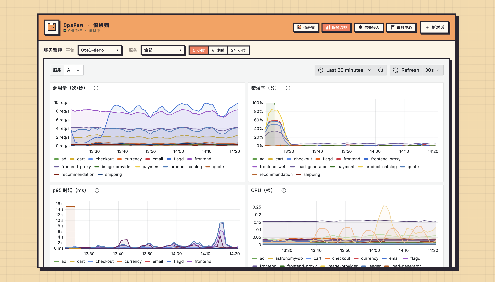
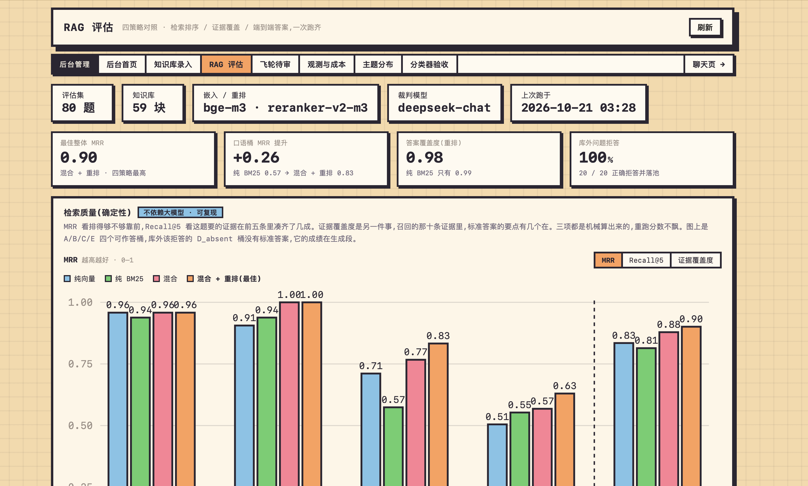

# OpsPaw 值班猫

面向运维值班的对话应用。当前 `mjt` 分支包含会话与工具、平台监控、诊断归因、修复连接器、告警巡检、事故中心、管理作业和可选成本观测。

## 项目展示

以下截图展示完整项目界面，RAG 功能正在整合中。

### 值班对话与巡检



### 运维知识问答



### 服务监控



### RAG 评估



## 本地运行

需要 Python 3.12 及以上和 uv。复制 `.env.example` 为 `.env`，填写模型及数据库连接；不要覆盖已有配置。

```bash
uv sync --locked
uv run uvicorn app.main:app --host 127.0.0.1 --port 8000
```

应用会创建当前代码使用的表。常用页面：`/` 对话、`/platforms` 平台与监控、`/diagnosis?id=任务号` 诊断、`/repair/任务号` 修复回执、`/alerts` 告警巡检、`/incidents` 事故中心、`/admin` 管理、`/observability` 成本观测、`/topics` 主题分类。

Prometheus、Jaeger、Loki、Grafana 和修复连接器按需配置。开发阶段不需要 Docker；演示 MCP 服务可运行 `bash scripts/start_mcp.sh`。

## 当前边界

诊断回放样例只覆盖确定性采集到候选排序，不代表真实模型归因准确率或线上效果。OpsAgent 的限制和待核查事项见 [`docs/diagnosis-validation.md`](docs/diagnosis-validation.md)。

Langfuse 是可选项：在部署环境填写 `.env` 中的 `LANGFUSE_*` 后，可从管理页生成 token 用量报告。未配置或尚未生成报告时，页面会明确显示状态。

主题分类页面提供独立推理服务入口；模型文件不随仓库提交，需要先按 `scripts/ch10/README.md` 提供训练产物。RAG 问题池、知识库及其分类分布未合入此分支，不显示模拟统计。

当前依赖和部署说明见 [`DEPLOY.md`](DEPLOY.md)。
